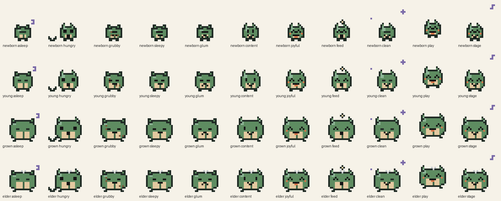

# Art

## The creature

The Hingeling is a small bush sprite with a squat, pebble-shaped body, two
folded-leaf ears, a sandstone belly and a crease down its middle, like a little
book that opens and closes. It grows wider at each life stage and picks up a
silver tuft as an elder.

## Originality

The design was drawn from scratch for this project.

- It doesn't hatch from an egg and the body isn't egg-shaped: it has a flat base and wide shoulders.
- There's no device frame, button row or toy shell around it.
- No character, silhouette, logo, colour scheme or name is taken from any existing virtual pet, game or brand.
- The palette is ten colours taken from Australian bush at dusk: moss and eucalyptus greens, sandstone, dusk violet, an ember blush, silver-grey and mud brown.

If anyone adds art, keep to these rules and add a line here saying what was added.

## How the art is built

The sprites are code, not image files. `Sources/PocketPetCore/Art/` builds each
24 by 24 frame from small text stamps, which means:

- every change shows up in a normal diff and can be reviewed line by line
- the art builds and is tested on Linux with `swift test`
- there are no binary assets to keep in sync

| File | What it does |
| --- | --- |
| `PixelPalette.swift` | The ten colours and the symbol for each palette slot |
| `PixelFrame.swift` | A 24 by 24 grid of palette slots, with stamp and shift helpers |
| `PetSprites.swift` | The body for each life stage, faces for each mood, reactions and the stage routine |
| `PetAnimator.swift` | Picks the frame to show for a given time, reaction and Reduce Motion setting |
| `PetState+Samples.swift` | Pets in any mood and stage, for previews and tests |

`App/Sources/Art/PetSpriteView.swift` draws a frame in SwiftUI.

## Poses

| Pose | Frames | Timing |
| --- | --- | --- |
| A loop for each mood (asleep, hungry, grubby, sleepy, glum, content, joyful) at each life stage | 2 to 5 | 0.5 s a frame |
| One-shot reactions: feed, clean, play | 4 to 6 | 0.18 s a frame, then back to the loop |
| Stage routine for the half-fold scene | 4 | 0.5 s a frame |

An asleep pet stays asleep on stage rather than dancing.

## Scaling and motion

- The view picks the largest whole-number scale that fits the space, so a pixel is always a whole number of points.
- Each pixel is filled as a solid square, so there's no smoothing between pixels.
- With Reduce Motion on, the view holds the first frame of the current pose and skips reactions.

## Regenerating the contact sheet

The contact sheet is a review aid only and isn't bundled with the app. If you
change the art, regenerate it so the picture in this file matches the code.
