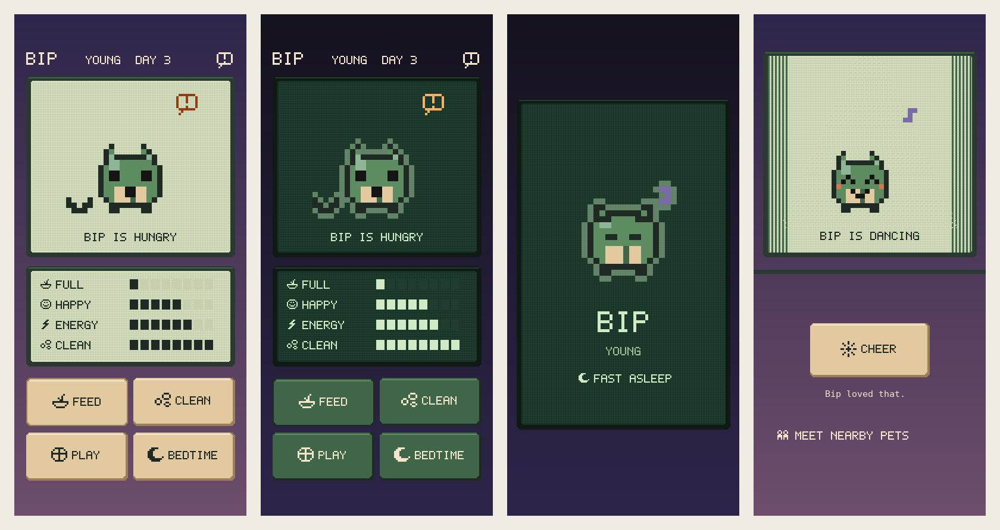

# Interface

The interface borrows the feel of a late-90s handheld pet without copying any of them.

## What we took from the era

These are traits that many devices, games and apps of the time shared:

- **A pixel LCD.** Content sits on a pale screen with a faint grid of unlit pixels showing through, inside a dark bezel with a moulded highlight along the top.
- **A backlight.** Dark mode is the backlight being on: a deep green glow with light ink, and a one-pixel glowing edge around the pet so its dark outline doesn't vanish.
- **Blocky lettering.** Names, captions and button labels use a 5 by 7 pixel alphabet drawn for this project (`PixelFont`).
- **Status icons.** A small set of 9 by 9 icons (`PixelIcon`) for food, bubbles, a ball, the moon, the sun, energy and so on, plus a blinking "needs you" bubble.
- **Segmented meters.** Needs show as eight blocks, like a battery bar, not as smooth progress bars.
- **Chunky keys.** Buttons are raised keycaps that press down, with stepped pixel corners.

## What we deliberately avoided

From `docs/art.md`: no egg-shaped shell, no three-button toy frame, and no layouts, icons or colours from any existing virtual pet, toy or game brand. In practice:

- Needs are not shown as rows of hearts.
- There is no ring of menu icons around the screen.
- The actions are labelled keycaps in a two-by-two grid, not three unlabelled round buttons under a screen.
- Every colour comes from the creature's own bush-at-dusk palette (`RetroPalette`).

## Accessibility

- Pixel lettering is decoration. Each piece of it carries the real words for VoiceOver ("Bip is hungry", not "BIP IS HUNGRY"), and sentences such as refusals and notices use the system monospaced font, so Dynamic Type works normally.
- Pixel text still grows with Dynamic Type in whole-pixel steps, up to a cap so big lettering doesn't crowd everything else out.
- Every text colour pair meets WCAG AA (4.5:1) in both palettes. `RetroPaletteTests` checks this on every build.
- The "needs you" bubble stops blinking when Reduce Motion is on.

## Where it lives

| Piece | File |
| --- | --- |
| Pixel font, icons, meter maths, palette, sprite halo | `Sources/PocketPetCore/Retro/` (tested on Linux) |
| LCD panel, keycap button style, pixel text and icon views, segmented meter, backdrop | `App/Sources/Retro/RetroTheme.swift` |
| Mockup above | `scripts/ui-mockup.py` (reads the font, icons and palette from the Swift sources) |

To regenerate the mockup, run `scripts/ui-mockup.py`.
